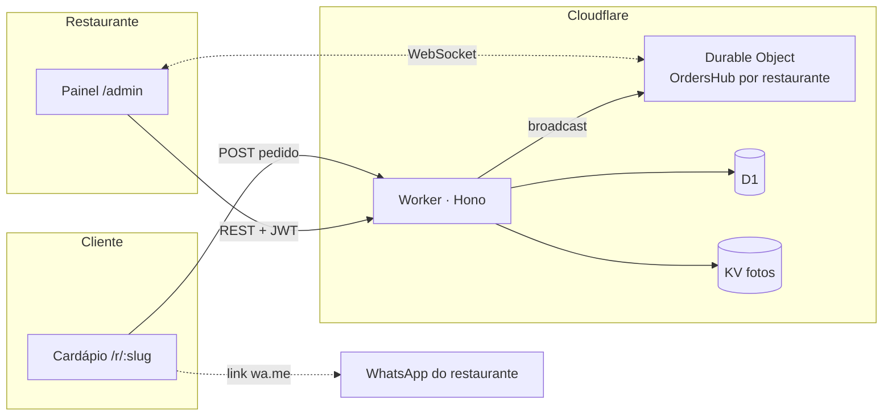
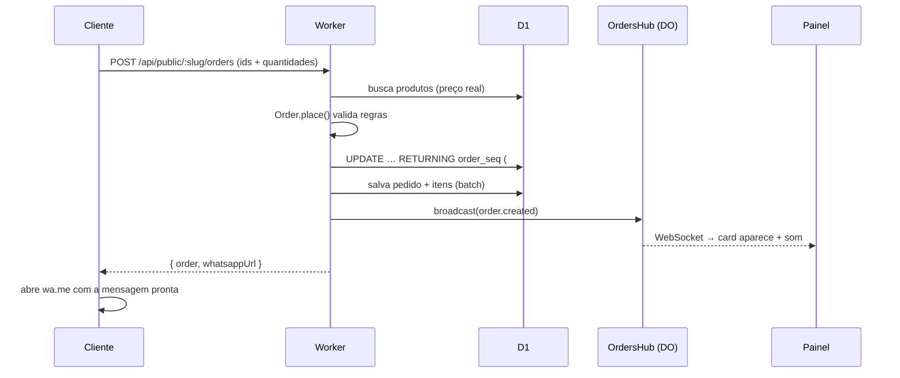

# Comandaí 🍕💬

[](https://github.com/Felipecluiz/comandai/actions/workflows/ci.yml)

🔗 **Site no ar:** [comandai.pages.dev](https://comandai.pages.dev) · **Cardápio de exemplo:** [Pizzaria do Zé](https://comandai.pages.dev/r/pizzaria-do-ze) · **Painel de demonstração:** `demo@comandai.dev` / `demo1234`

**Cardápio digital multi-restaurante com pedidos pelo WhatsApp e painel da cozinha em tempo real** — rodando 100% na edge da Cloudflare.

O cliente abre `/r/pizzaria-do-ze`, monta a sacola e finaliza. O pedido é **salvo no painel do restaurante** (que toca um som e aparece no kanban na hora) e o cliente é levado ao **WhatsApp** com a mensagem pronta.

Projeto de portfólio com foco em **Clean Architecture**, **Clean Code** e **Spec-Driven Development**. Projeto irmão: **FinTrack** (controle financeiro, mesma stack e metodologia).

| | |
|---|---|
| **API** | Cloudflare **Workers** + Hono + Zod |
| **Banco** | Cloudflare **D1** (SQLite) |
| **Fotos** | Cloudflare **Workers KV** |
| **Tempo real** | **Durable Objects** + WebSocket Hibernation API |
| **Front** | React + Vite no **Pages**, TanStack Query, Recharts |
| **Auth** | PBKDF2 (WebCrypto) + JWT HS256 |
| **Testes** | Vitest + `@cloudflare/vitest-pool-workers` (D1/KV/DO reais no Miniflare) |

---

## ✨ Funcionalidades

**Cliente (sem login)**
- Cardápio por categorias com fotos, abas fixas e status aberto/fechado
- Sacola persistente por restaurante, observação por item
- Checkout com entrega/retirada, Pix/cartão/dinheiro (com troco) e pedido mínimo
- Mensagem formatada e envio via `wa.me`

**Restaurante (painel)**
- Cadastro self-service com link próprio (`/r/<slug>`)
- **Kanban de pedidos ao vivo** com som, destaque e alerta de atraso
- Fluxo `Novo → Aceito → Em preparo → Pronto → Saiu para entrega → Concluído` (ou cancelado com motivo)
- Gestão do cardápio: categorias ordenáveis, produtos com foto, pausar item esgotado
- Dashboard: faturamento, ticket médio, cancelados, receita por dia e top 5 produtos
- Abrir/fechar a loja com um clique

---

## 🧭 Spec-Driven Development

Todo código nasce de uma spec em [`specs/`](./specs):

| Spec | Destaques |
|---|---|
| [000 Constitution](./specs/000-constitution/constitution.md) | regras de arquitetura, multi-tenant, dinheiro e segurança |
| [001 Tenants & auth](./specs/001-tenants-auth/spec.md) | slug, WhatsApp normalizado, login |
| [002 Catálogo](./specs/002-catalog/spec.md) | categorias, produtos, fotos no KV |
| [003 Checkout + WhatsApp](./specs/003-checkout-whatsapp/spec.md) | preço no servidor, número sequencial, mensagem |
| [004 Painel](./specs/004-orders-panel/spec.md) | máquina de estados + tempo real |
| [005 Dashboard](./specs/005-dashboard/spec.md) | agregações por dia no fuso do restaurante |
| [006 Adicionais](./specs/006-addons/spec.md) | 📝 proposta (próximo passo) |

Regras (`BR-003.1`) e critérios de aceite (`AC-004.2`) aparecem nos nomes dos testes:

```ts
it("AC-003.2 ignora preço enviado pelo cliente", ...)
it("AC-004.2 retirada não sai para entrega", ...)
```

Decisões técnicas em [`docs/adr/`](./docs/adr): ports para recursos Cloudflare, multi-tenant por coluna, `wa.me` vs Cloud API, Durable Objects, snapshot de preço.

---

## 🏛️ Arquitetura



```
apps/api/src/
├── domain/            ← TypeScript puro: Order (máquina de estados), Product, Restaurant,
│                        Money, Phone, Slug, formatOrderMessage()
├── application/       ← casos de uso + ports (ImageStorage, OrderNotifier, TokenService…)
├── infrastructure/    ← d1/ · kv/ · durable-objects/ · crypto/ · memory/
├── interface/http/    ← rotas Hono, auth, presenters, erro → HTTP
└── main.ts            ← composition root (único lugar com classes concretas)
```

### Fluxo de um pedido



### Decisões que valem a leitura
- **O servidor é a fonte do preço** — o schema descarta qualquer `priceCents` vindo do cliente (ADR-0005).
- **Snapshot de itens** — reajustar o cardápio não altera pedidos antigos nem relatórios.
- **Máquina de estados no domínio** — a API devolve `allowedTransitions` e o front só renderiza os botões; a regra não é duplicada.
- **Multi-tenant seguro** — `restaurantId` vem só do JWT; recurso de outro restaurante responde 404.
- **Numeração atômica** — `UPDATE … RETURNING` garante `#1, #2, #3` sem colisão.
- **Tempo real barato** — Hibernation API: o Durable Object dorme entre pedidos.
- **Storage trocável** — as fotos saíram do R2 para o KV (sem cartão de crédito) trocando só um adapter; domínio e casos de uso intactos (ADR-0006).
- **Notificação nunca derruba pedido** — falha no broadcast é logada; o painel ressincroniza ao reconectar.

---

## 🚀 Rodando localmente

Pré-requisitos: Node 22+, pnpm 9+.

```bash
pnpm install                       # gera o pnpm-lock.yaml — faça commit dele
cp apps/api/.dev.vars.example apps/api/.dev.vars

pnpm db:migrate:local
pnpm db:seed:local                 # Pizzaria do Zé + 30 dias de pedidos

pnpm dev                           # API :8787 · Web :5173
```

- Cardápio: http://localhost:5173/r/pizzaria-do-ze
- Painel: http://localhost:5173/login — `demo@comandai.dev` / `demo1234`

Dica: abra o painel numa aba e faça um pedido pelo cardápio em outra — o card aparece na hora, com som.

```bash
pnpm test        # unitários + integração (D1, KV e Durable Object no Miniflare)
pnpm typecheck
pnpm lint
```

## ☁️ Deploy automático

Todo push na `main` passa por **lint → typecheck → testes → migrations D1 → deploy da API → deploy do Pages → smoke test** no GitHub Actions ([`.github/workflows/ci.yml`](./.github/workflows/ci.yml)). Pull requests rodam só a validação.

Configuração inicial em **um comando** — cria os recursos na Cloudflare e configura secrets/variables no GitHub:

```bash
pnpm setup:deploy
```

Detalhes, alternativa manual e rollback: **[docs/DEPLOY.md](./docs/DEPLOY.md)**.

---

## 📡 API

| Método | Rota | Auth |
|---|---|---|
| POST | `/api/auth/register` · `/api/auth/login` | — |
| GET | `/api/public/:slug/menu` | — |
| POST | `/api/public/:slug/orders` | — |
| GET | `/api/images/:key` | — |
| GET/PATCH | `/api/admin/restaurant` | JWT |
| GET | `/api/admin/catalog` | JWT |
| POST/PATCH/DELETE | `/api/admin/categories[/:id]` · PUT `/categories/order` | JWT |
| POST/PATCH/DELETE | `/api/admin/products[/:id]` · PUT `/products/:id/image` | JWT |
| GET | `/api/admin/orders?scope=active\|recent` | JWT |
| PATCH | `/api/admin/orders/:id/status` | JWT |
| WS | `/api/admin/orders/stream?token=` | JWT |
| GET | `/api/admin/dashboard?period=today\|7d\|30d` | JWT |

Erros: `{ "error": { "code": "PRODUCT_UNAVAILABLE", "message": "...", "details": { "campo": ["..."] } } }`

## 🗺️ Roadmap

- [ ] 006 — Adicionais/complementos (borda, extras)
- [ ] Horários de funcionamento automáticos (Cron Triggers)
- [ ] Cupons de desconto
- [ ] Acompanhamento do pedido pelo cliente (mesmo Durable Object, canal público)
- [ ] WhatsApp Cloud API como `OrderNotifier` alternativo

## 📷 Créditos

As fotos da página inicial vêm do [Unsplash](https://unsplash.com) e são usadas sob a [Unsplash License](https://unsplash.com/license). A "Padaria Trigal" e os produtos mostrados são fictícios.
