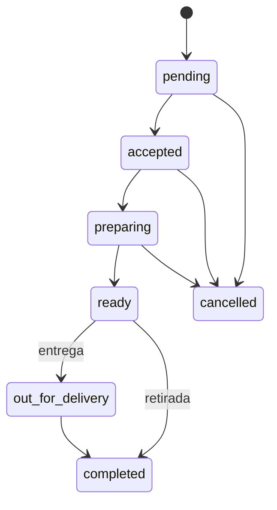

# 004 — Painel de pedidos · Spec

**Status:** Implementada · **Depende de:** 003

## Contexto
A cozinha precisa ver pedidos chegando **sem atualizar a página** e mover cada um pelo fluxo.

## User stories
- **US-004.1** Como restaurante, quero ver os pedidos em colunas por status (kanban).
- **US-004.2** Como restaurante, quero ser avisado (som + destaque) quando chega pedido novo.
- **US-004.3** Como restaurante, quero avançar ou cancelar um pedido.
- **US-004.4** Como restaurante, quero abrir o WhatsApp do cliente a partir do pedido.

## Máquina de estados (BR-004.1)

## Regras de negócio
- **BR-004.1** Só transições do diagrama são válidas; `out_for_delivery` só existe para entrega.
- **BR-004.2** Cancelamento exige motivo (3–140 caracteres).
- **BR-004.3** Cada mudança registra o horário no histórico do pedido.
- **BR-004.4** Toda criação/mudança de pedido é publicada em tempo real **apenas** para os painéis do mesmo restaurante.
- **BR-004.5** Listagem padrão: pedidos abertos + finalizados/cancelados das últimas 24h.

## Critérios de aceite
- **AC-004.1** *Given* pedido `pending`, *when* mudo para `ready`, *then* 422 `INVALID_STATUS_TRANSITION`.
- **AC-004.2** *Given* pedido de retirada `ready`, *when* mudo para `out_for_delivery`, *then* 422.
- **AC-004.3** *When* cancelo sem motivo, *then* 422.
- **AC-004.4** *Given* painel conectado, *when* um pedido é criado, *then* recebe o evento `order.created` sem recarregar.
- **AC-004.5** *When* tento mudar pedido de outro restaurante, *then* 404.
